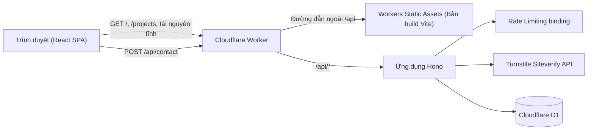
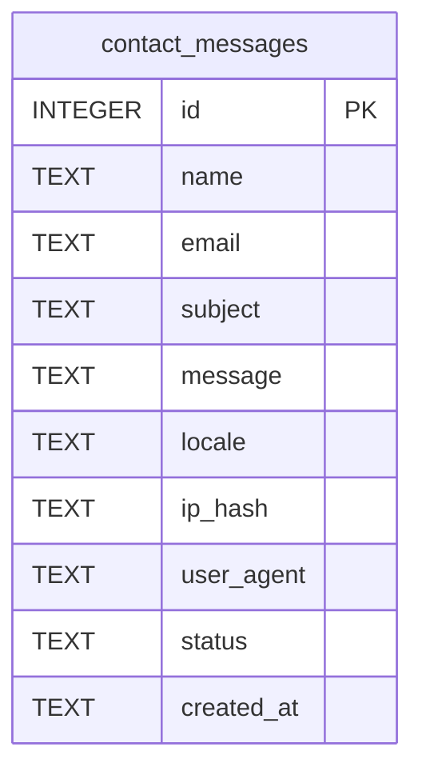
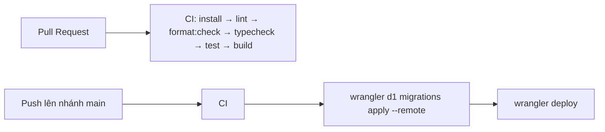

# 03 – Đề xuất Kiến trúc Hệ thống (Architecture Proposal)

> Trạng thái: Đã hoàn thành triển khai kỹ thuật Giai đoạn 3–6 (Frontend, Contact API + D1 + Turnstile, CSP/`_headers`, ErrorBoundary, Lazy Loading, Accessibility & 102 automated tests PASS). Chờ kiểm toán Lighthouse/axe để nghiệm thu Stage 6.

## 1. Tổng quan kiến trúc

Một **Cloudflare Worker** (dịch vụ điện toán biên serverless của Cloudflare) duy nhất đảm nhận cả việc phục vụ ứng dụng giao diện **React SPA** (thông qua **Workers Static Assets**) và hệ thống REST API viết bằng **Hono** dưới đường dẫn `/api/*`. Các yêu cầu gửi biểu mẫu liên hệ được xác thực chống bot bằng **Turnstile**, giới hạn tần suất (rate-limited), kiểm tra dữ liệu đầu vào bằng **Zod** và lưu trữ vào cơ sở dữ liệu **D1**.



Lý do chọn kiến trúc một Worker duy nhất: triển khai một lần (single deployment), cùng nguồn gốc tên miền (same-origin – không cần cấu hình CORS phức tạp), dùng chung một tên miền, nằm trong gói miễn phí và đơn giản hóa tối đa việc vận hành. Xem chi tiết tại ADR-002 trong tài liệu [05](./05-technical-decisions.md).

## 2. Cấu trúc Monorepo

Trình quản lý gói: **pnpm workspaces** (không dùng Turborepo hay Nx vì không cần thiết với quy mô dự án này).

```text
giabao-portfolio/
├─ apps/
│  ├─ web/                    # React + Vite + Tailwind + React Router (SPA)
│  │  ├─ public/              # cv/, images/, robots.txt, sitemap.xml, favicon
│  │  ├─ src/
│  │  │  ├─ app/              # router, layout, providers (theme, i18n)
│  │  │  ├─ pages/            # Home, About, Experience, Projects, ProjectDetail, Contact, NotFound
│  │  │  ├─ components/       # Các thành phần giao diện tái sử dụng
│  │  │  ├─ content/          # Dữ liệu nội dung có kiểu tĩnh (en.ts, vi.ts) – nguồn dữ liệu hồ sơ duy nhất
│  │  │  ├─ i18n/             # Từ điển đa ngôn ngữ + hàm bổ trợ
│  │  │  ├─ lib/              # API client, các hàm tiện ích
│  │  │  └─ styles/
│  │  └─ tests/               # Kiểm thử thành phần giao diện/đơn vị (Vitest + Testing Library)
│  └─ api/                    # Hono Worker (điểm vào chính của gói triển khai)
│     ├─ src/
│     │  ├─ index.ts          # Điểm vào Worker: ứng dụng Hono + điều hướng dự phòng về tài nguyên tĩnh
│     │  ├─ routes/           # contact.ts, health.ts
│     │  ├─ services/         # turnstile.ts, contact-repository.ts
│     │  ├─ middleware/       # error-handler, rate-limit, security-headers, body-limit
│     │  └─ env.ts            # Định nghĩa kiểu cho Bindings (biến môi trường & tài nguyên gắn kết)
│     ├─ test/                # Kiểm thử tích hợp với Vitest (Workers pool)
│     └─ wrangler.jsonc       # Cấu hình bindings: ASSETS, DB, RATE_LIMITER, vars
├─ packages/
│  └─ shared/                 # Lược đồ Zod + kiểu TypeScript dùng chung (contact payload, cấu trúc phản hồi API)
├─ db/
│  └─ migrations/             # Các file SQL migration cho D1 (0001_create_contact_messages.sql, ...)
├─ docs/                      # Bộ tài liệu kiến trúc và thiết kế dự án
├─ .github/workflows/         # ci.yml, deploy.yml
├─ eslint.config.js           # Cấu hình ESLint dạng phẳng (flat config) dùng chung
├─ .prettierrc
├─ tsconfig.base.json
├─ pnpm-workspace.yaml
└─ package.json
```

Quy tắc phân định ranh giới (Boundary rules):
- `apps/web` không được phép import trực tiếp từ `apps/api` (chỉ được import từ `packages/shared`).
- `packages/shared` không phụ thuộc vào thư viện thực thi nào ngoài `zod`; đảm bảo chạy được trên cả trình duyệt và môi trường Workers (runtime-agnostic).
- Các câu lệnh SQL chỉ được đặt trong `db/migrations` và `contact-repository.ts`.
- Dữ liệu kinh nghiệm tại WinSoft trong `apps/web/src/content/` hiển thị chức danh chính thức `Database & Data Intern` và chỉ chứa mô tả tổng quát (SQL Server, T-SQL, Stored Procedures, phân tích dữ liệu, báo cáo viện phí), tuyệt đối không chứa tên khách hàng/bệnh viện, database schema, tên bảng, tên cột, dữ liệu bệnh nhân, quy trình nội bộ có tính bảo mật hay hình ảnh hệ thống nội bộ.
- Dữ liệu dự án trong `apps/web/src/content/` chỉ tạo một mục duy nhất cho MONO APP (gộp chung MONO APP và App Money Tracker); ghi nhận database của dự án Coffee Shop E-commerce là `Supabase`; giữ trạng thái chờ xác nhận (`projectType: null` / Pending Confirmation) cho phân loại từng dự án thuộc nhóm `Academic Projects` hay `Personal Projects`.

> Vị trí đặt kiểm thử: các bài kiểm thử đơn vị và tích hợp nằm ngay cạnh từng ứng dụng (`apps/*/test`) để mỗi gói tự hoàn chỉnh; thư mục `tests/e2e/` ở cấp gốc (dùng Playwright) có thể bổ sung sau nếu cần, không nằm trong phạm vi MVP (Minimum Viable Product – sản phẩm khả dụng tối thiểu).

## 3. Kiến trúc Frontend

| Khía cạnh | Giải pháp tiếp cận |
|---|---|
| Công cụ đóng gói (Build) | Vite (kết hợp `@cloudflare/vite-plugin` để đồng bộ môi trường phát triển cục bộ với Worker – sẽ kiểm tra tương thích ở Giai đoạn 2) |
| Định tuyến (Routing) | React Router, sử dụng tiền tố ngôn ngữ: `/en/...`, `/vi/...`; đường dẫn gốc `/` tự động chuyển hướng dựa theo lựa chọn đã lưu → ngôn ngữ trình duyệt → mặc định `en` |
| Đa ngôn ngữ (i18n) | Từ điển có kiểu dữ liệu chặt chẽ tự xây dựng (`Record<Locale, Messages>`) + React context. Không cần thư viện i18n bên ngoài cho 2 ngôn ngữ với nội dung tĩnh. |
| Quản lý nội dung (Content) | Các module TypeScript có kiểu chặt chẽ trong `src/content/`; mỗi ngôn ngữ một file. Hệ thống kiểu đảm bảo cả hai ngôn ngữ có tập khóa (keys) đồng nhất. Tuân thủ quy tắc bảo mật WinSoft (chức danh `Database & Data Intern`, chỉ mô tả tổng quát, không chứa schema/bảng/cột, dữ liệu bệnh nhân, thông tin bệnh viện, quy trình nội bộ hay ảnh nội bộ) và không tự suy đoán các trường dự án đang ở trạng thái Pending Confirmation. |
| Giao diện Sáng/Tối (Theme) | Tailwind `darkMode: 'class'`; đoạn mã script nhỏ đặt trực tiếp (inline) trong `index.html` để gán class trước khi trình duyệt vẽ giao diện nhằm chống chớp màn hình (FOUC); lưu lựa chọn vào `localStorage`. |
| Biểu mẫu (Forms) | Controlled form (biểu mẫu được kiểm soát trạng thái bởi React) kết hợp lược đồ Zod dùng chung để kiểm tra phía trình duyệt. Tích hợp Turnstile widget theo chế độ hiển thị tường minh (explicit render). |
| Tối ưu tìm kiếm (SEO) | Quản lý thẻ `<title>`, `<meta name="description">`, thẻ **canonical URL** (`<link rel="canonical">`), thẻ ngôn ngữ thay thế (`hreflang`) và bộ thẻ **Open Graph** (`og:title`, `og:description`, `og:url`, `og:image`, `og:type`, `og:locale`) theo từng đường dẫn (route). Cung cấp file tĩnh `sitemap.xml` và `robots.txt`. Thực hiện kiểm tra khả năng lập chỉ mục của React SPA (xem mục 3.1 và ADR-006). |
| Tải CV | Lưu tại `public/cv/Nguyen-Gia-Bao-CV-EN.pdf` (và `-VI.pdf`), sử dụng thẻ liên kết `<a download>` tiêu chuẩn. |

### 3.1 Chiến lược SEO cho React SPA

Vì dự án sử dụng kiến trúc React SPA (render phía trình duyệt), cần áp dụng đầy đủ các biện pháp kỹ thuật sau để tối ưu khả năng thu thập dữ liệu của các công cụ tìm kiếm:
1. **Canonical URL & Hreflang**: Mỗi route (`/en/...`, `/vi/...`) tự động cập nhật thẻ `<link rel="canonical" href="https://<domain>/<locale>/<path>" />` và các thẻ `<link rel="alternate" hreflang="en|vi|x-default" ... />` tương ứng để tránh trùng lặp nội dung giữa hai ngôn ngữ.
2. **Open Graph & Meta mặc định**: Trong `index.html` luôn có sẵn bộ thẻ `<title>`, `<meta name="description">` và bộ thẻ Open Graph (`og:title`, `og:description`, `og:image`, `og:url`, `og:type`) hoàn chỉnh để các trình thu thập không chạy JavaScript (như bot xem trước liên kết của LinkedIn, Facebook, Zalo, Slack) vẫn đọc được thông tin chuẩn. Khi chuyển route trên trình duyệt, một thành phần quản lý `<head>` nhẹ sẽ cập nhật lại tiêu đề, mô tả và canonical URL tương ứng.
3. **Sitemap & Robots**: Cung cấp `public/robots.txt` cho phép thu thập toàn bộ các trang công khai và trỏ rõ tới `Sitemap: https://<domain>/sitemap.xml`. File `public/sitemap.xml` liệt kê đầy đủ các URL ngôn ngữ (`/en`, `/vi`, `/en/projects`, `/vi/projects`, ...).
4. **Kiểm tra khả năng lập chỉ mục (SPA Indexability Verification)**: Trong Giai đoạn 6 và Giai đoạn 8, thực hiện kiểm tra thực tế bằng Lighthouse SEO audit, kiểm tra kết xuất DOM (Document Object Model) sau khi tải trang, kiểm tra hiển thị thẻ Open Graph và sử dụng công cụ URL Inspection (Google Search Console) sau khi triển khai để xác nhận bot tìm kiếm lập chỉ mục được các route của SPA.

### 3.2 Design System, Typography, Theme, i18n & Content Architecture (Giai đoạn 3)

#### Design Tokens (Tailwind CSS v4)
- Toàn bộ tokens được khai báo tập trung tại `apps/web/src/styles/tokens.css` (import vào `apps/web/src/styles/index.css`) thông qua CSS custom properties (`:root` cho Light theme, `.dark` cho Dark theme) kết hợp `@custom-variant dark (&:where(.dark, .dark *));` và `@theme inline`.
- **Bảng màu định hướng (WCAG AA):**
  - **Dark theme**: nền deep navy (`#070d19`, `#0c1527`), surface nâng cấp (`#111c33`, `#172542`), chữ sáng (`#f1f5f9`, `#cbd5e1`, `#94a3b8`), accent cyan (`#38bdf8`).
  - **Light theme**: nền trắng (`#ffffff`, `#f8fafc`), surface xám trung tính (`#f1f5f9`, `#ffffff`), chữ tối (`#0f172a`, `#334155`, `#475569`), accent blue (`#1d4ed8`).
- **Tokens bổ sung**: spacing section (`section-sm/md/lg`), border radius (`sm/md/lg/xl/full`), shadows thích ứng theo theme (`shadow-sm/md/lg`), container widths (`42rem`, `56rem`, `72rem`, `80rem`) và transition durations (`150ms`, `200ms`, `300ms`).
- **Quy ước bắt buộc**: Component chỉ sử dụng semantic token classes (`bg-bg-primary`, `bg-surface-primary`, `text-text-primary`, `text-accent-primary`, `border-border-subtle`...), không hardcode mã màu tùy tiện.

#### Typography
- Chỉ sử dụng 2 họ font: `Inter` (sans-serif, hỗ trợ đầy đủ tiếng Việt có dấu) và `JetBrains Mono` (monospace cho code/SQL/nhãn kỹ thuật), tải qua Google Fonts với `display=swap` và hệ thống fallback chuẩn.
- Thang chữ chuẩn hóa gồm 8 cấp: `display`, `h1`, `h2`, `h3`, `body`, `small`, `caption`, `code`, sử dụng thống nhất qua component `<Typography>`.

#### Theme Architecture
- Một `ThemeProvider` duy nhất (`apps/web/src/app/providers/ThemeProvider.tsx`) hỗ trợ 3 chế độ: `light`, `dark`, `system`.
- Lưu lựa chọn vào `localStorage` với khóa `giabao-portfolio-theme`, lắng nghe sự kiện thay đổi `prefers-color-scheme` khi ở chế độ `system`.
- Chống FOUC bằng đoạn inline script trong `<head>` của `apps/web/index.html` chạy đồng bộ trước khi React mount để gán class `.dark`, `data-theme` và `color-scheme` lên `<html>`.

#### i18n Architecture
- Từ điển định kiểu chặt chẽ tại `apps/web/src/i18n/` (`types.ts`, `en.ts`, `vi.ts`, `index.ts`), không dùng thư viện i18n bên ngoài. TypeScript kiểm tra sự trùng khớp toàn bộ key giữa `en` và `vi`.
- Định tuyến song ngữ với React Router: `/` tự động chuyển hướng sang `/en` hoặc `/vi` (ưu tiên `localStorage` → `navigator.language` → mặc định `en`); `LocaleLayout` kiểm tra tham số `:locale` và bọc `I18nProvider` để đồng bộ `<html lang>`, `document.title` và chuyển đổi ngôn ngữ giữ nguyên đường dẫn con.

#### Content Models (`apps/web/src/content/`)
- Mô hình dữ liệu định kiểu chặt chẽ trong `types.ts` gồm: `Profile`, `Education`, `Experience` (`kind: "technical" | "non-technical"`), `Project` (`projectType: "academic" | "personal" | null`), `Skill` (`proficiency` không tự bịa), `Certification`.
- Dữ liệu tách riêng theo ngôn ngữ (`en.ts`, `vi.ts`) và truy xuất qua `getPortfolioContent(locale)`:
  - WinSoft giữ chức danh chính thức `Database & Data Intern`, chỉ mô tả tổng quát, không chứa schema/bảng/cột/dữ liệu bệnh nhân/thông tin bệnh viện hay ảnh hệ thống nội bộ.
  - MONO APP và App Money Tracker được gộp thành một bản ghi `Project` duy nhất (`id: "mono-app"`).
  - Toàn bộ 3 dự án giữ `projectType: null`, `repositoryUrl: null`, `demoUrl: null` cho đến khi được xác nhận.
  - Coffee Shop E-commerce đã ghi nhận database `Supabase` theo xác nhận chính thức của chủ dự án tại tài liệu 02 §9.1.

#### Base UI Components & Responsive Foundation
- Bộ 10 component cơ sở tại `apps/web/src/components/ui/`: `Button`, `IconButton`, `Container`, `Section`, `Card`, `Badge`, `Typography`, `ThemeToggle`, `LanguageSwitcher`, `Divider`.
- Quy ước: props TypeScript rõ ràng, hỗ trợ đầy đủ `hover`, `focus-visible`, `disabled`, ARIA attributes, không cài thư viện icon/UI lớn (dùng SVG inline tối giản).
- Responsive breakpoints chuẩn: `sm` (640px), `md` (768px), `lg` (1024px), `xl` (1280px), `2xl` (1440px). Đã kiểm soát `overflow-x: clip`, touch target ≥ 36–44px trên mobile và bố cục `RootLayout` với thanh điều hướng sẵn sàng mở rộng cho Stage 4.

## 4. Kiến trúc Backend (Hono trên Cloudflare Workers)

### 4.1 Danh sách Endpoints

| Phương thức | Đường dẫn | Mục đích | Mã phản hồi HTTP |
|---|---|---|---|
| GET | `/api/health` | Kiểm tra trạng thái hoạt động và kết nối D1 (`SELECT 1`) | `200` / `503` |
| POST | `/api/contact` | Gửi tin nhắn từ biểu mẫu liên hệ | `201`, `400`, `403`, `413`, `415`, `429`, `500`, `503` |

> **Chính sách bảo mật endpoint**: Hệ thống **chỉ** có endpoint ghi tin nhắn (`POST /api/contact`), tuyệt đối **không** cung cấp bất kỳ endpoint công khai nào để đọc, liệt kê hay tìm kiếm tin nhắn đã gửi.

### 4.2 Luồng xử lý yêu cầu liên hệ (Contact Request Pipeline)

```mermaid
sequenceDiagram
    participant C as Client (Trình duyệt)
    participant W as Worker (Hono)
    participant R as Rate Limiter
    participant T as Turnstile Siteverify
    participant D as Cloudflare D1
    C->>W: POST /api/contact (JSON + turnstileToken)
    W->>W: 1-2. Kiểm tra Content-Type (415) và kích thước body 10 KB (413)
    W->>R: 3. limit(key = CF-Connecting-IP)
    R-->>W: Cho phép? (nếu vượt ngưỡng -> 429; lỗi/thiếu binding -> 500)
    W->>W: 4. Parse JSON object (nếu sai -> 400)
    W->>W: 5. Kiểm tra Honeypot (website là string có nội dung sau trim -> trả 201 giả, không gọi Turnstile, không lưu DB)
    W->>W: 6. Kiểm tra dữ liệu với Zod (loại bỏ trường website trước khi parse; nếu sai -> 400)
    W->>T: 7. Gọi Siteverify POST (secret, token, remoteip; timeout bao phủ cả fetch và đọc body)
    T-->>W: Phản hồi? (timeout/lỗi mạng/5xx -> 503; success=false/sai hostname/action -> 403)
    W->>W: 8-9. Hash IP (SHA-256 + IP_HASH_SALT) và chuẩn hóa User-Agent (<= 512 ký tự)
    W->>D: 10. INSERT (prepared statement, chỉ lưu ip_hash)
    D-->>W: Thành công
    W-->>C: 201 { ok: true }
```

Lý do sắp xếp thứ tự xử lý: thực hiện các bước kiểm tra chi phí thấp trước (Content-Type, giới hạn kích thước 10 KB, giới hạn tần suất, parse JSON, kiểm tra honeypot trước Zod để bot thiếu `turnstileToken` vẫn nhận phản hồi thành công giả và không làm lộ lỗi validation honeypot) trước khi gọi ra dịch vụ Turnstile bên ngoài và ghi vào cơ sở dữ liệu D1.

### 4.3 Quy ước Dữ liệu Yêu cầu / Phản hồi (Request / Response Contract)

#### A. Response Envelope thống nhất (áp dụng cho toàn bộ `/api/*`)

Thành công:

```json
{
  "ok": true
}
```

Hoặc có trường `data` cho endpoint trả dữ liệu trạng thái như `GET /api/health`:

```json
{
  "ok": true,
  "data": {
    "status": "healthy",
    "database": "connected"
  }
}
```

Thất bại:

```json
{
  "ok": false,
  "error": {
    "code": "VALIDATION_ERROR",
    "message": "Dữ liệu không hợp lệ",
    "fields": {
      "email": "Địa chỉ email không đúng định dạng"
    }
  }
}
```

#### B. Quy tắc kiểm tra dữ liệu (`packages/shared` – Zod v4, đồng bộ với `0001_create_contact_messages.sql`)

Phạm vi **Checkpoint 5.3** (đã tích hợp Rate Limiting binding, Cloudflare Turnstile Siteverify, Honeypot, Hash IP và User-Agent ở backend; giao diện frontend `ContactSection.tsx` sẽ tích hợp Turnstile widget ở checkpoint frontend tiếp theo):

| Trường | Kiểu | Quy tắc validation (Zod + SQL CHECK) | Chuẩn hóa |
|---|---|---|---|
| `name` | `string` (bắt buộc) | 1–100 ký tự sau khi trim, từ chối chuỗi rỗng / toàn khoảng trắng | `.trim()` |
| `email` | `string` (bắt buộc) | Tối đa 254 ký tự, đúng định dạng email (`z.email()`), từ chối chuỗi rỗng | `.trim()` |
| `subject` | `string` (tùy chọn) | Tối đa 150 ký tự sau khi trim | `.trim()`; chuỗi rỗng / toàn khoảng trắng → `undefined` (lưu `NULL` trong D1) |
| `message` | `string` (bắt buộc) | 10–5000 ký tự sau khi trim, từ chối chuỗi rỗng | `.trim()` |
| `locale` | `'en' \| 'vi'` (bắt buộc) | Chỉ chấp nhận `'en'` hoặc `'vi'` | Giữ nguyên giá trị hợp lệ |
| `turnstileToken` | `string` (bắt buộc) | 1–2048 ký tự sau khi trim | `.trim()` |
| `website` | `string` (tùy chọn – honeypot) | Không đặt giới hạn độ dài, không strip trước bước kiểm tra honeypot | Giữ nguyên để backend phát hiện bot (trả `201` giả, không gọi Turnstile, không ghi D1) |

Các trường lạ không khai báo trong schema bị Zod tự động loại bỏ.

Giới hạn kỹ thuật đầu vào cho `POST /api/contact`:
- Header `Content-Type` bắt buộc có media type là `application/json`.
- Kích thước request body tối đa: **10 KB** (`10240` bytes).
- Cột `ip_hash` lưu `SHA-256(IP + IP_HASH_SALT)` dạng hex 64 ký tự (hoặc `NULL` nếu thiếu `CF-Connecting-IP` hoặc thiếu `IP_HASH_SALT`). Đây là dữ liệu **giả danh hóa (pseudonymized)**, không phải dữ liệu ẩn danh tuyệt đối.
- Cột `user_agent` lưu header `User-Agent` đã chuẩn hóa và cắt tối đa **512 ký tự** (hoặc `NULL` nếu không có).

#### C. Bảng ánh xạ mã trạng thái HTTP và mã lỗi (`ApiErrorCode`)

| HTTP Status | Mã lỗi (`error.code`) | Trạng thái | Ý nghĩa |
|---|---|---|---|
| `200 OK` | — | Đã triển khai | `GET /api/health` hoạt động bình thường, D1 trả về `SELECT 1`. |
| `201 Created` | — | Đã triển khai | `POST /api/contact` lưu tin nhắn thành công vào D1 (`{ "ok": true }`) hoặc phản hồi thành công giả cho honeypot bot. |
| `400 Bad Request` | `VALIDATION_ERROR` | Đã triển khai | JSON sai cú pháp / không phải object, hoặc dữ liệu không khớp lược đồ Zod (trả kèm `error.fields`). |
| `403 Forbidden` | `TURNSTILE_FAILED` | Đã triển khai (5.3) | Token Turnstile không hợp lệ, hết hạn, đã dùng, không khớp `hostname` hoặc `action`. |
| `404 Not Found` | `NOT_FOUND` | Đã triển khai | Đường dẫn `/api/*` không tồn tại. |
| `413 Payload Too Large` | `PAYLOAD_TOO_LARGE` | Đã triển khai | Kích thước request body vượt quá 10 KB (`10240` bytes). |
| `415 Unsupported Media Type` | `UNSUPPORTED_MEDIA_TYPE` | Đã triển khai | Header `Content-Type` không phải `application/json`. |
| `429 Too Many Requests` | `RATE_LIMITED` | Đã triển khai (5.3) | Vượt quá giới hạn tần suất gửi theo `CF-Connecting-IP` (5 req / 60s theo colo). |
| `500 Internal Server Error` | `INTERNAL_ERROR` | Đã triển khai | Lỗi ghi cơ sở dữ liệu D1, lỗi binding hoặc lỗi hệ thống nội bộ (không lộ SQL/stack trace). |
| `503 Service Unavailable` | `SERVICE_UNAVAILABLE` | Đã triển khai | `GET /api/health` không kết nối được tới D1. |
| `503 Service Unavailable` | `TURNSTILE_UNAVAILABLE` | Đã triển khai (5.3) | Dịch vụ Turnstile Siteverify timeout, lỗi mạng, trả lỗi HTTP hoặc thiếu cấu hình secret/hostname. |

#### D. Ví dụ Request / Response

1. **`GET /api/health` (Thành công – `200 OK`)**

```json
{
  "ok": true,
  "data": {
    "status": "healthy",
    "database": "connected"
  }
}
```

   **`GET /api/health` (Lỗi kết nối D1 – `503 Service Unavailable`)**

```json
{
  "ok": false,
  "error": {
    "code": "SERVICE_UNAVAILABLE",
    "message": "Dịch vụ tạm thời không khả dụng"
  }
}
```

2. **`POST /api/contact` (Thành công – `201 Created`)**

Request:

```json
{
  "name": "Nguyen Van A",
  "email": "recruiter@company.com",
  "subject": "Backend Developer Role",
  "message": "Xin chào Gia Bảo, tôi muốn trao đổi về vị trí Backend Developer.",
  "locale": "vi"
}
```

Response:

```json
{
  "ok": true
}
```

3. **`POST /api/contact` (Lỗi dữ liệu – `400 Bad Request`)**

```json
{
  "ok": false,
  "error": {
    "code": "VALIDATION_ERROR",
    "message": "Dữ liệu không hợp lệ",
    "fields": {
      "email": "Địa chỉ email không đúng định dạng",
      "message": "Nội dung tin nhắn phải có ít nhất 10 ký tự"
    }
  }
}
```

#### E. Hướng dẫn chạy API cục bộ và kiểm tra Endpoint

1. **Áp dụng migration D1 cục bộ** (chạy từ thư mục `apps/api`):

```bash
pnpm --filter @giabao-portfolio/api exec wrangler d1 migrations apply giabao-portfolio-db --local
```

2. **Khởi chạy API Worker cục bộ**:

```bash
pnpm --filter @giabao-portfolio/api exec wrangler dev
```

Mặc định Wrangler chạy tại `http://127.0.0.1:8787` (hoặc chạy full-stack qua `pnpm dev` với `@cloudflare/vite-plugin`).

3. **Kiểm tra endpoint bằng `curl`**:

```bash
# Kiểm tra health
curl -i http://127.0.0.1:8787/api/health

# Gửi tin nhắn hợp lệ
curl -i -X POST http://127.0.0.1:8787/api/contact \
  -H "Content-Type: application/json" \
  -d "{\"name\":\"Nguyen Van A\",\"email\":\"recruiter@company.com\",\"subject\":\"Backend Role\",\"message\":\"Xin chào, tôi muốn trao đổi về vị trí Backend Developer.\",\"locale\":\"vi\"}"

# Kiểm tra dữ liệu đã lưu trong D1 cục bộ
pnpm --filter @giabao-portfolio/api exec wrangler d1 execute giabao-portfolio-db --local --command "SELECT id, name, email, subject, locale, status, created_at FROM contact_messages ORDER BY id DESC LIMIT 5;"
```

### 4.4 Các chốt kiểm soát bảo mật (Security Controls)

| Chốt kiểm soát | Cách thức triển khai |
|---|---|
| Kiểm tra đầu vào (Input validation) | Dùng Zod (`safeParse`), tự động loại bỏ các trường lạ không khai báo; trả về `400` khi dữ liệu không hợp lệ |
| Chống bot (Bot protection) | Xác thực Turnstile phía máy chủ qua Siteverify; kiểm tra thêm `hostname`; phân biệt rõ lỗi token không hợp lệ/hết hạn (`403`) với lỗi dịch vụ Siteverify gặp sự cố/không phản hồi (`503`) |
| Giới hạn tần suất (Rate limiting) | Sử dụng **Rate Limiting binding** của Workers, định danh theo header `CF-Connecting-IP` (ADR-005) |
| Chống SQL Injection | Chỉ sử dụng câu lệnh chuẩn bị trước (prepared statements) của D1 với phương thức `.bind()` |
| Xử lý lỗi & Ghi log an toàn | Bộ bắt lỗi toàn cục `app.onError` trả về cấu trúc lỗi `500` chung; chỉ ghi mã lỗi kỹ thuật qua `console.error` (Workers Logs), **tuyệt đối không ghi log nội dung tin nhắn, email hay IP gốc** |
| Quản lý khóa bí mật (Secrets) | Lưu `TURNSTILE_SECRET_KEY`, `IP_HASH_SALT` qua lệnh `wrangler secret put`; đưa file `.dev.vars` vào `.gitignore` |
| Header bảo mật | Thiết lập `Content-Security-Policy` (cho phép `challenges.cloudflare.com` cho Turnstile), `X-Content-Type-Options`, `Referrer-Policy`, `Permissions-Policy` |
| Giới hạn kích thước gói tin | Middleware `bodyLimit` của Hono (~10 KB) |
| CORS | Không bật (do frontend và API chạy cùng một origin) |
| Quyền riêng tư & Dữ liệu cá nhân (PII) | Không lưu IP gốc (chỉ lưu mã băm `SHA-256(IP + salt)`); thu thập dữ liệu tối thiểu; không mở endpoint công khai để đọc tin nhắn |

## 5. Mô hình Dữ liệu & Chính sách Lưu trữ (D1 / SQLite)



Nội dung dự kiến của file migration `db/migrations/0001_create_contact_messages.sql` (chỉ mô tả trong tài liệu – chưa tạo file code):

```sql
CREATE TABLE contact_messages (
  id          INTEGER PRIMARY KEY AUTOINCREMENT,
  name        TEXT NOT NULL CHECK (length(name) BETWEEN 1 AND 100),
  email       TEXT NOT NULL CHECK (length(email) <= 254),
  subject     TEXT CHECK (subject IS NULL OR length(subject) <= 150),
  message     TEXT NOT NULL CHECK (length(message) BETWEEN 10 AND 5000),
  locale      TEXT NOT NULL CHECK (locale IN ('en','vi')),
  ip_hash     TEXT,
  user_agent  TEXT,
  status      TEXT NOT NULL DEFAULT 'new' CHECK (status IN ('new','read','archived','spam')),
  created_at  TEXT NOT NULL DEFAULT (strftime('%Y-%m-%dT%H:%M:%fZ','now'))
);
CREATE INDEX idx_contact_messages_created_at ON contact_messages (created_at DESC);
CREATE INDEX idx_contact_messages_status ON contact_messages (status);
```

Các ràng buộc `CHECK` ở cấp cơ sở dữ liệu được cố tình thiết kế trùng khớp với giới hạn của Zod (nguyên lý phòng thủ theo chiều sâu – defense in depth, một điểm nhấn kỹ thuật cần có đối với portfolio định hướng cơ sở dữ liệu). Các bản migration được áp dụng bằng lệnh `wrangler d1 migrations apply` (từ môi trường local tới remote).

### 5.1 Chính sách Bảo mật & Vòng đời Dữ liệu Liên hệ

1. **Hạn chế thu thập dữ liệu (Data Minimization)**: Chỉ thu thập các trường phục vụ trực tiếp cho việc liên hệ (`name`, `email`, `subject`, `message`, `locale`) và chống lạm dụng (`ip_hash`, `user_agent`). Không thu thập số điện thoại, vị trí địa lý hay cookie theo dõi.
2. **Bảo vệ địa chỉ IP và nội dung tin nhắn**:
   - Địa chỉ IP gốc từ `CF-Connecting-IP` chỉ được dùng trong bộ nhớ tạm để kiểm tra rate limit, gọi Turnstile Siteverify và băm một chiều `SHA-256(ip + IP_HASH_SALT)` (chuỗi hex 64 ký tự) trước khi lưu vào cột `ip_hash`. IP gốc không bao giờ được ghi xuống đĩa hay log. **Lưu ý kỹ thuật:** `ip_hash` là dữ liệu **giả danh hóa (pseudonymized)**, không phải dữ liệu ẩn danh tuyệt đối (vì không gian IPv4 hữu hạn và nếu lộ `IP_HASH_SALT` có thể bị tra ngược).
   - Không ghi log (`console.log` / `console.error`) nội dung trường `message`, `email`, `name`, `turnstileToken`, nội dung honeypot, IP gốc, `TURNSTILE_SECRET_KEY`, `IP_HASH_SALT` hay toàn bộ `User-Agent` trong mọi tình huống (kể cả khi xảy ra lỗi).
   - Chi tiết hướng dẫn cấu hình Turnstile, Worker secrets và Rate Limiting binding xem tại [06-contact-security-setup.md](./06-contact-security-setup.md).
3. **Không có Endpoint đọc dữ liệu công khai**: Không xây dựng route `GET /api/contact` hay bất kỳ API đọc tin nhắn nào. Chủ dự án chỉ truy vấn dữ liệu trực tiếp qua giao diện quản trị Cloudflare D1 hoặc công cụ dòng lệnh `wrangler d1 execute` đã xác thực.
4. **Thời hạn lưu trữ và kế hoạch xóa dữ liệu cũ**:
   - **Thời hạn lưu trữ đề xuất**: **180 ngày** kể từ thời điểm tạo bản ghi (`created_at`) (**⚠ CHỜ XÁC NHẬN** phê duyệt từ chủ dự án).
   - **Kế hoạch xóa dữ liệu cũ**: Sử dụng truy vấn dọn dẹp định kỳ:
     ```sql
     DELETE FROM contact_messages WHERE created_at < strftime('%Y-%m-%dT%H:%M:%fZ', 'now', '-180 days');
     ```
   - **Phương thức thực thi**: Có thể chạy tự động bằng **Cloudflare Workers Cron Triggers** (lịch chạy `scheduled()` hàng tuần/hàng tháng trên chính Worker này) hoặc chạy lệnh bảo trì định kỳ qua `wrangler d1 execute`. Phương thức cụ thể sẽ được chốt cùng chủ dự án ở Giai đoạn 5.

## 6. Cấu hình, Tên miền & Môi trường (Configuration, Domain & Environments)

- **Nền tảng hosting và tên miền (đã xác nhận):** Triển khai trên **Cloudflare Workers**, ưu tiên sử dụng tên miền miễn phí mặc định dạng `<worker-name>.<subdomain>.workers.dev` (hiện chưa mua custom domain).
- **Trạng thái triển khai hiện tại:** Chưa triển khai môi trường production.

| Môi trường | Worker | Tên miền (Domain) | Cơ sở dữ liệu D1 | Khóa Turnstile |
|---|---|---|---|---|
| local (Cục bộ) | `wrangler dev` / Vite plugin | `localhost` | SQLite cục bộ (Miniflare) | Khóa **kiểm thử (test keys)** của Cloudflare (luôn qua / luôn chặn) |
| production (Sản phẩm – chưa triển khai) | `giabao-portfolio` | `*.workers.dev` (miễn phí, chưa dùng custom domain) | `giabao-portfolio-db` | Site key thật (biến công khai) + Secret key thật (gắn với hostname `*.workers.dev`) |

Môi trường `preview` là tùy chọn (tạo URL xem trước cho mỗi PR) – sẽ quyết định ở Giai đoạn 6.

Các tài nguyên gắn kết (Bindings trong `wrangler.jsonc`): `ASSETS` (tài nguyên tĩnh, cấu hình điều hướng dự phòng SPA `not_found_handling: "single-page-application"`, ưu tiên chạy Worker trước `run_worker_first` cho `/api/*`), `DB` (D1), `RATE_LIMITER` (ratelimit), biến môi trường công khai `TURNSTILE_SITE_KEY`, khóa bí mật `TURNSTILE_SECRET_KEY`, `IP_HASH_SALT`.

## 7. Chiến lược Kiểm thử (Testing Strategy)

| Tầng kiểm thử | Công cụ | Phạm vi |
|---|---|---|
| Lược đồ dùng chung (Shared schemas) | Vitest | Dữ liệu hợp lệ/không hợp lệ, các giá trị biên về độ dài |
| Tích hợp API (API integration) | Vitest + `@cloudflare/vitest-pool-workers` | Chạy trên môi trường Workers thực tế, D1 cục bộ đã chạy migration, giả lập (mock) lệnh `fetch` tới Turnstile; bao phủ đầy đủ các mã trạng thái `201`, `400`, `403`, `413`, `415`, `429`, `500`, `503` và kiểm tra việc không lưu IP gốc / không lộ lỗi nội bộ |
| Giao diện (Frontend) | Vitest + Testing Library + jsdom | Chuyển đổi giao diện Sáng/Tối, chuyển đổi ngôn ngữ, các trạng thái của biểu mẫu liên hệ |
| Kiểm thử thủ công (Manual) | Danh sách kiểm tra (Checklist) | Hiển thị đa màn hình, khả năng tiếp cận (axe/Lighthouse), SEO & khả năng lập chỉ mục SPA, tổ hợp 2 giao diện × 2 ngôn ngữ |

Định hướng độ bao phủ kiểm thử (Coverage): Giữ mức **≥ 90%** cho `apps/api` và `packages/shared` làm **mục tiêu tham khảo**, nhưng ưu tiên cao nhất là kiểm thử triệt để các luồng nghiệp vụ cốt lõi và các tình huống xử lý lỗi quan trọng (xác thực dữ liệu `400`, token Turnstile sai/hết hạn `403`, dịch vụ Turnstile sập/timeout `503`, vượt ngưỡng gửi `429`, lỗi cơ sở dữ liệu `500`, bẫy honeypot và bảo mật dữ liệu). Đối với frontend, tập trung kiểm thử thực dụng vào các thành phần quan trọng.

## 8. Tích hợp và Triển khai Liên tục (CI/CD)



- Sử dụng GitHub Actions với `cloudflare/wrangler-action`; các khóa bí mật `CLOUDFLARE_API_TOKEN`, `CLOUDFLARE_ACCOUNT_ID` được lưu trong GitHub Secrets.
- Phương án thay thế: Cloudflare Workers Builds (tích hợp trực tiếp với Git). Xem quyết định tại ADR-009.

## 9. Các thành phần chủ đích không đưa vào dự án

Trang quản trị (admin dashboard), endpoint công khai đọc tin nhắn, hệ thống đăng nhập/xác thực, CMS, SSR framework, ORM (Object-Relational Mapping – thư viện ánh xạ đối tượng quan hệ), thư viện quản lý trạng thái toàn cục phức tạp, thông báo qua email (đang chờ xác nhận), bộ kiểm thử E2E nặng nề, Turborepo/Nx, Docker images.
