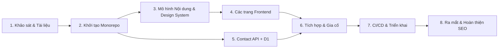

# 04 – Lộ trình Phát triển (Development Roadmap)

> Mỗi giai đoạn kết thúc bằng một **cổng phê duyệt (approval gate)**. Không bắt đầu giai đoạn tiếp theo nếu chưa có sự chấp thuận rõ ràng từ chủ dự án.

## Tổng quan các giai đoạn

| Giai đoạn | Tên giai đoạn | Ước tính thời gian | Trạng thái |
|---|---|---|---|
| 1 | Khảo sát & Tài liệu hóa (Discovery & Documentation) | 0.5 ngày | ✅ Đã hoàn thành |
| 2 | Khởi tạo Monorepo & Công cụ (Monorepo Scaffold & Tooling) | 1 ngày | ✅ Đã hoàn thành |
| 3 | Mô hình Nội dung, Đa ngôn ngữ & Hệ thống Thiết kế (Content Model, i18n & Design System) | 1.5 ngày | ✅ Đã hoàn thành |
| 4 | Xây dựng các trang Frontend (Frontend Pages) | 2–3 ngày | ✅ Đã hoàn thành |
| 5 | Contact API, Cơ sở dữ liệu D1 & Bảo mật (Contact API, D1 & Security) | 2 ngày | ✅ Đã hoàn thành |
| 6 | Tích hợp, Kiểm thử & Gia cố hệ thống (Integration, Testing & Hardening) | 1.5 ngày | 🔄 Đang hoàn thiện (chờ Lighthouse/axe & nghiệm thu) |
| 7 | CI/CD & Triển khai Cloudflare (CI/CD & Cloudflare Deployment) | 1 ngày | Chờ thực hiện |
| 8 | Ra mắt, Tối ưu SEO & Hoàn thiện (Launch, SEO & Polish) | 1 ngày | Chờ thực hiện |

Thời gian ước tính dựa trên hình thức làm việc độc lập bán thời gian và chỉ mang tính chất tham khảo.

---

## Giai đoạn 1 – Khảo sát & Tài liệu hóa ✅
- [x] Đặc tả yêu cầu (01), kiểm kê nội dung (02), đề xuất kiến trúc (03), lộ trình phát triển (04), nhật ký quyết định kỹ thuật ADR (05) – đã chuẩn hóa sang tiếng Việt.
- [x] Cập nhật các thông tin đã được chủ dự án xác nhận: chức danh và phạm vi bảo mật tại WinSoft, gộp MONO APP và App Money Tracker thành một mục dự án duy nhất, ghi nhận hai nhóm dự án Academic Projects và Personal Projects (trạng thái từng dự án: Pending Confirmation), cập nhật database của Coffee Shop E-commerce là `Supabase`, và chốt phương án hosting Cloudflare Workers với domain miễn phí `*.workers.dev` (chưa triển khai production).
- **Cổng phê duyệt (Gate):** Chủ dự án phê duyệt bộ tài liệu và phản hồi các câu hỏi vẫn đang chờ xác nhận tại tài liệu 02 §9.2 trước hoặc trong các giai đoạn liên quan.

## Giai đoạn 2 – Khởi tạo Monorepo & Công cụ
1. Khởi tạo `git init`, `.gitignore`, `.editorconfig`, `.nvmrc` (Node bản LTS – hỗ trợ dài hạn).
2. Thiết lập pnpm workspace: `apps/web`, `apps/api`, `packages/shared`, `db/migrations`.
3. Cấu hình `tsconfig.base.json` (bật chế độ `strict`, `noUncheckedIndexedAccess`) và `tsconfig.json` riêng cho từng gói.
4. Cấu hình ESLint dạng phẳng (typescript-eslint, react-hooks, jsx-a11y) + Prettier (kèm plugin sắp xếp class Tailwind).
5. Khởi tạo ứng dụng Vite React TypeScript; cài đặt Tailwind CSS và React Router.
6. Tạo khung ứng dụng Hono Worker với endpoint `/api/health`; cấu hình `wrangler.jsonc` gắn kết `ASSETS` và điều hướng dự phòng SPA.
7. Cấu hình Vitest cho từng gói (sử dụng Workers pool cho `apps/api`).
8. Thiết lập các lệnh chạy ở thư mục gốc: `dev`, `build`, `lint`, `format`, `typecheck`, `test`.
9. Kiểm tra việc chạy đồng thời Worker và tài nguyên tĩnh ở môi trường cục bộ chỉ bằng một lệnh duy nhất.

**Tiêu chí hoàn thành (Exit criteria):** Tổ hợp lệnh `pnpm lint && pnpm typecheck && pnpm test && pnpm build` chạy thành công hoàn toàn; môi trường phát triển cục bộ phục vụ được cả giao diện SPA và `/api/health`.

## Giai đoạn 3 – Mô hình Nội dung, Đa ngôn ngữ & Hệ thống Thiết kế ✅
- [x] Định nghĩa kiểu dữ liệu cho nội dung (`Profile`, `Education`, `Experience`, `Project`, `Skill`, `Certification`) tại `apps/web/src/content/types.ts` với `kind: 'technical' | 'non-technical'` và `projectType: 'academic' | 'personal' | null` (giữ `null` cho 3 dự án chờ xác nhận; gộp MONO APP và App Money Tracker thành một bản ghi duy nhất; không tự suy đoán database của Coffee Shop E-commerce).
- [x] Biên soạn dữ liệu song ngữ `apps/web/src/content/en.ts` và `vi.ts` tuân thủ nghiêm ngặt quy định bảo mật WinSoft (`Database & Data Intern`, chỉ mô tả tổng quát, không schema/dữ liệu bệnh nhân/thông tin bệnh viện).
- [x] Xây dựng `I18nProvider`, từ điển định kiểu chặt chẽ (`apps/web/src/i18n/`), định tuyến `/en` và `/vi`, `LanguageSwitcher` và đồng bộ `<html lang>`.
- [x] Xây dựng `ThemeProvider` (Dark / Light / System) lưu `localStorage`, lắng nghe `prefers-color-scheme`, kèm inline script chống FOUC trong `apps/web/index.html`.
- [x] Thiết lập Design Tokens bằng Tailwind CSS v4 (`tokens.css`) và Typography (`Inter` + `JetBrains Mono`) đạt chuẩn tương phản WCAG AA; tạo 10 Base UI Components (`Button`, `IconButton`, `Container`, `Section`, `Card`, `Badge`, `Typography`, `ThemeToggle`, `LanguageSwitcher`, `Divider`) và Responsive Foundation (`RootLayout`).
- [x] Viết kiểm thử tự động (Vitest + Testing Library) cho Theme, i18n, Content models và Base UI Components.

**Tiêu chí hoàn thành:** `pnpm format:check`, `pnpm lint`, `pnpm typecheck`, `pnpm test`, `pnpm build` đều đạt; bảng màu đạt chuẩn WCAG AA; sẵn sàng nghiệm thu trước khi sang Giai đoạn 4.

## Giai đoạn 4 – Xây dựng các trang Frontend
1. Bố cục chung (Layout): thanh điều hướng đáp ứng thiết bị di động (responsive navbar), chân trang (footer) chứa liên kết mạng xã hội.
2. Trang chủ / Hero: tiêu đề định vị chuyên môn, tóm tắt ngắn, các nút CTA, nút tải CV.
3. Trang Giới thiệu (About) + Học vấn (Education).
4. Trang Kinh nghiệm (Experience): dòng thời gian làm nổi bật kinh nghiệm kỹ thuật tại WinSoft với chức danh `Database & Data Intern` (mô tả tổng quát, bảo mật), tách riêng mục kinh nghiệm khác.
5. Mục Kỹ năng (Skills): các thẻ kỹ năng phân nhóm + bảng chú giải thuật ngữ y tế (HIS, BHYT, LIS, CDHA).
6. Trang Danh sách dự án và Chi tiết dự án: hiển thị 3 dự án (trong đó MONO APP và App Money Tracker là một mục dự án duy nhất, và database của Coffee Shop E-commerce là `Supabase`); hỗ trợ hai nhóm `Academic Projects` và `Personal Projects` nhưng ẩn nhãn phân loại của từng dự án khi đang ở trạng thái Pending Confirmation; ẩn đường dẫn repository hoặc các trường khác khi chưa được xác nhận.
7. Mục Chứng chỉ (chỉ hiển thị các trường đã được chủ dự án xác nhận).
8. Giao diện trang Liên hệ (Contact): các trạng thái biểu mẫu (chờ nhập / đang gửi / thành công / báo lỗi), vùng hiển thị widget Turnstile.
9. Trang báo lỗi 404.

**Tiêu chí hoàn thành:** Toàn bộ các trang hiển thị chuẩn xác trên cả 2 ngôn ngữ (EN/VI) × 2 giao diện (Dark/Light) ở các độ rộng màn hình 375 / 768 / 1280 px; hỗ trợ điều hướng hoàn chỉnh bằng bàn phím.

## Giai đoạn 5 – Contact API, Cơ sở dữ liệu D1 & Bảo mật
1. Xây dựng lược đồ Zod `contactSchema` và kiểu dữ liệu phản hồi dùng chung trong `packages/shared`.
2. Tạo file migration `0001_create_contact_messages.sql` và áp dụng trên môi trường D1 cục bộ.
3. Xây dựng các lớp trung gian (Middleware): header bảo mật, giới hạn kích thước gói tin (`413`), kiểm tra `Content-Type` (`415`), bộ xử lý lỗi toàn cục (không ghi log nội dung tin nhắn).
4. Cấu hình Rate Limiting binding và middleware giới hạn tần suất theo IP (`429`).
5. Xây dựng dịch vụ xác thực Turnstile (gọi Siteverify có thiết lập timeout, kiểm tra `hostname`; trả về `403` khi token không hợp lệ/hết hạn và trả về `503` khi dịch vụ Siteverify không phản hồi hoặc gặp sự cố).
6. Xây dựng tầng truy cập dữ liệu (Repository) sử dụng prepared statements; băm địa chỉ IP bằng Web Crypto `SHA-256` kèm muối (không lưu IP gốc); thiết lập cơ chế/truy vấn dọn dẹp dữ liệu quá hạn (đề xuất 180 ngày – chờ phê duyệt). Đảm bảo không mở bất kỳ endpoint công khai nào để đọc tin nhắn.
7. Kết nối route `POST /api/contact` theo đúng luồng xử lý tại tài liệu 03 §4.2.
8. Viết bài kiểm thử tích hợp (integration tests) cho toàn bộ các luồng nghiệp vụ và tình huống lỗi (`201`, `400`, `403`, `413`, `415`, `429`, `500`, `503`).

**Tiêu chí hoàn thành:** Toàn bộ các luồng nghiệp vụ chính và tình huống lỗi quan trọng của API được kiểm thử đầy đủ (hướng tới mục tiêu tham khảo coverage ≥ 90%); không có bất kỳ phản hồi hay dòng log nào làm lộ chi tiết lỗi nội bộ, IP gốc hoặc nội dung tin nhắn.

## Giai đoạn 6 – Tích hợp, Kiểm thử & Gia cố hệ thống
1. Kết nối biểu mẫu frontend với API; ánh xạ lỗi của từng trường dữ liệu vào ô nhập liệu tương ứng; hiển thị thông báo lỗi theo ngôn ngữ đang chọn (bao gồm thông báo thân thiện khi gặp lỗi `403`, `429`, `503`).
2. Cấu hình khóa kiểm thử Turnstile ở môi trường cục bộ; tự động làm mới (reset) widget sau mỗi lần gửi thất bại.
3. Hoàn thiện chính sách `Content-Security-Policy` (cho phép tên miền của Turnstile) và kiểm tra trực tiếp trên trình duyệt.
4. Kiểm toán khả năng tiếp cận (Accessibility audit bằng axe / Lighthouse) và khắc phục các vấn đề phát hiện được.
5. Tối ưu hiệu năng: tối ưu hóa hình ảnh, tách mã theo đường dẫn (route-level code splitting) nếu cần.
6. Viết kiểm thử frontend cho biểu mẫu liên hệ, bộ chuyển đổi giao diện và bộ chuyển đổi ngôn ngữ.

**Tiêu chí hoàn thành:** Điểm Lighthouse đạt ≥ 90 ở tất cả các hạng mục trên thiết bị di động; vượt qua toàn bộ danh sách kiểm tra thủ công.

## Giai đoạn 7 – CI/CD & Triển khai Cloudflare (Hiện chưa triển khai production)
1. Khởi tạo cơ sở dữ liệu D1 trên Cloudflare (`wrangler d1 create`) và cập nhật ID vào file cấu hình.
2. Tạo Turnstile widget trên bảng điều khiển Cloudflare (cấu hình hostname cho tên miền `*.workers.dev` và `localhost`).
3. Thiết lập các khóa bí mật trên môi trường thực tế (`TURNSTILE_SECRET_KEY`, `IP_HASH_SALT`).
4. Thiết lập GitHub Actions: `ci.yml` (chạy khi tạo PR) và `deploy.yml` (chạy khi gộp vào nhánh `main`: chạy migration D1 → triển khai Worker).
5. Sử dụng tên miền miễn phí dạng `*.workers.dev` của Cloudflare Workers (đã xác nhận ưu tiên `workers.dev` và hiện chưa mua custom domain).
6. Kiểm tra nhanh sau triển khai (smoke test): gọi `/api/health`, gửi thử một biểu mẫu liên hệ thực tế và kiểm tra bản ghi trong D1.

**Tiêu chí hoàn thành:** Quy trình CI/CD chạy xanh; hệ thống production truy cập ổn định; xác nhận thành công một lượt gửi liên hệ thực tế vào D1.

## Giai đoạn 8 – Ra mắt, Tối ưu SEO & Hoàn thiện
1. Hoàn thiện và kiểm tra toàn diện hệ thống SEO: thẻ `<title>`, `<meta name="description">`, **canonical URL**, thẻ ngôn ngữ `hreflang`, bộ thẻ **Open Graph** kèm ảnh đại diện khi chia sẻ, file `sitemap.xml` và `robots.txt`.
2. Kiểm tra thực tế khả năng lập chỉ mục (indexability) của ứng dụng React SPA đối với các công cụ tìm kiếm và trình thu thập dữ liệu mạng xã hội.
3. Tích hợp Cloudflare Web Analytics (tùy chọn, nếu chủ dự án xác nhận).
4. Viết tài liệu `README.md` chuyên nghiệp (sơ đồ kiến trúc, hướng dẫn cài đặt cục bộ, các quyết định kỹ thuật nổi bật) hướng tới nhà tuyển dụng.
5. Bổ sung chính dự án GiaBao Portfolio vào danh mục dự án trên trang web.
6. Rà soát nội dung lần cuối cùng với chủ dự án (cả bản tiếng Anh và tiếng Việt, đặc biệt kiểm tra lại việc tuân thủ bảo mật thông tin WinSoft).

**Tiêu chí hoàn thành:** Chủ dự án nghiệm thu và ký duyệt chính thức.

---

## Quản trị Rủi ro & Biện pháp Giảm thiểu (Risks & Mitigations)

| Rủi ro | Biện pháp giảm thiểu |
|---|---|
| Thiếu thông tin đầu vào (CV, đường dẫn repo, phân loại dự án) làm chậm Giai đoạn 3–4 | Xây dựng mô hình dữ liệu cho phép ẩn các trường chưa xác nhận (`null`/tùy chọn); chủ dự án phản hồi sớm danh sách câu hỏi tại tài liệu 02 §9 |
| Đặc tính của Rate Limiting binding (giới hạn theo từng cụm máy chủ biên, nhất quán sau cùng) | Chấp nhận được ở quy mô trang portfolio cá nhân; Turnstile là lớp phòng thủ chính; phương án dự phòng dùng bảng đếm trong D1 đã được ghi nhận tại ADR-005 |
| Khả năng SEO của kiến trúc SPA hạn chế hơn so với SSR | Thiết lập đầy đủ thẻ meta mặc định, canonical URL, Open Graph, `sitemap.xml`, `robots.txt` và thực hiện kiểm tra khả năng lập chỉ mục của React SPA; nhà tuyển dụng chủ yếu truy cập trực tiếp từ liên kết trong CV (ADR-006) |
| Xung đột phiên bản công cụ mới (Vite plugin, Vitest Workers pool) | Cố định phiên bản chính xác ở Giai đoạn 2; đối chiếu tài liệu chính thức của Cloudflare tại thời điểm cài đặt |
| Rò rỉ thông tin bảo mật của WinSoft | Tuân thủ nguyên tắc chỉ mô tả nghiệp vụ và kỹ thuật tổng quát; cấm tuyệt đối tên khách hàng/bệnh viện, schema/bảng/cột và ảnh chụp nội bộ; chủ dự án duyệt trước khi công bố |
| Rủi ro về quyền riêng tư đối với dữ liệu người liên hệ | Hạn chế dữ liệu thu thập, chỉ lưu mã băm IP có muối, không log nội dung tin nhắn, không mở endpoint đọc tin nhắn, áp dụng thời hạn lưu trữ 180 ngày (chờ phê duyệt) kèm kế hoạch xóa dữ liệu cũ |
| Thư rác lọt qua được Turnstile | Kết hợp trường ẩn honeypot + giới hạn tần suất theo IP + cột `status='spam'` trong D1 để lọc bỏ |
